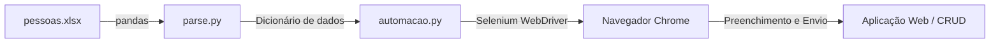

# 🤖 Automação de Cadastro de Usuários com Selenium

Este projeto realiza o **cadastro automatizado em lote de usuários** em uma aplicação web SPA utilizando **Python**, **Selenium WebDriver** e **Pandas**. 

O script lê os dados de uma planilha Excel (`pessoas.xlsx`) e simula o preenchimento humano no navegador campo a campo.

---

## ⚙️ Como Funciona o Fluxo



1. **`pessoas.xlsx`**: Planilha contendo as colunas `Nome`, `CPF`, `Tipo` e `Situação`.
2. **`parse.py`**: Lê o arquivo Excel via `pandas` e converte as linhas em um dicionário.
3. **`automacao.py`**: 
   - Inicializa o navegador via Google Chrome.
   - Acessa a aplicação em `http://127.0.0.1:8000/`.
   - Localiza os campos do formulário via ID (`cad-nome`, `cad-cpf`, `cad-tipo`, `cad-situacao`).
   - Preenche os dados de cada pessoa e clica no botão Gravar (`btn-gravar`).

---

## 📋 Pré-requisitos

- **Python 3.10+**
- **Navegador Google Chrome** instalado
- Dependências Python:

```bash
pip install selenium pandas openpyxl django
```

---

## 🚀 Como Executar

### 1. Inicie a aplicação web (alvo da automação)
Em um terminal, inicie o servidor local do Django:
```bash
python manage.py runserver
```
> O sistema estará acessível em `http://127.0.0.1:8000/`.

### 2. Execute o script de automação
Em outro terminal, execute o robô:
```bash
python automacao.py
```

O Chrome abrirá automaticamente em tela cheia e cadastrará todos os usuários presentes na planilha `pessoas.xlsx`.

---

## 🎯 Mapeamento dos Elementos Web (Selenium)

| Campo | Seletor | Identificador | Ação do Robô |
| :--- | :--- | :--- | :--- |
| **Nome** | `ID` | `cad-nome` | Limpa e digita o nome |
| **CPF** | `ID` | `cad-cpf` | Limpa e digita o CPF |
| **Tipo** | `ID` | `cad-tipo` | Limpa e digita o perfil/tipo |
| **Situação** | `ID` | `cad-situacao` | Limpa e digita a situação |
| **Gravar** | `ID` | `btn-gravar` | Clica para submeter o formulário |
